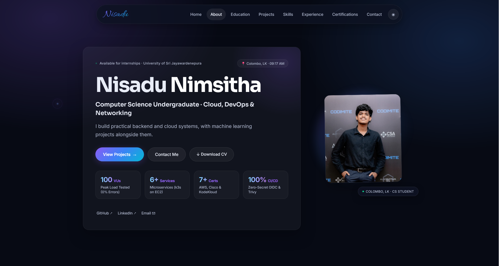

# Nisadu Nimsitha — Personal Portfolio

<p align="center">
  
</p>

<p align="center">
  <strong>Modern, high-performance personal portfolio built with React 18, Vite, and Node.js.</strong><br />
  Showcasing projects in Cloud Infrastructure, DevOps, Microservices, Machine Learning, and Full-Stack Engineering.
</p>

<p align="center">
  <a href="https://github.com/nisa2003-ops"></a>
  <a href="https://www.linkedin.com/in/nisadu-nimsitha-512a24348"></a>
  <a href="mailto:nisadu2003@gmail.com"></a>
</p>

<p align="center">
  
  
  
  
  
</p>

---

## 📌 Table of Contents

- [Overview](#-overview)
- [✨ Key Features](#-key-features)
- [🛠️ Tech Stack](#️-tech-stack)
- [📂 Project Structure](#-project-structure)
- [🚀 Quick Start](#-quick-start)
  - [Prerequisites](#prerequisites)
  - [Frontend Setup](#1-frontend-setup)
  - [Backend Setup (Optional)](#2-backend-setup-optional)
- [⚙️ Environment Variables](#️-environment-variables)
- [🚢 Build & Deployment](#-build--deployment)
- [👤 About the Author](#-about-the-author)
- [📄 License](#-license)

---

## 🌟 Overview

This repository contains the source code for the personal portfolio website of **Nisadu Nimsitha**, a Computer Science undergraduate at the **University of Sri Jayewardenepura** specializing in Cloud, DevOps, and Backend Engineering.

The site is built with a bespoke **Aurora Glass** design aesthetic, featuring dark/light mode support, hardware-accelerated animations, accessible interactive widgets, and deep project case studies.

---

## ✨ Key Features

- **🎨 Aurora Glass UI**: Custom glassmorphism styling powered by CSS Modules, smooth ambient blur gradients, and clean responsive micro-interactions.
- **🌓 Dynamic Light & Dark Mode**: Persistent theme toggle via custom React hook with zero flash of unstyled content.
- **📱 100% Mobile Responsive**: Adaptive navigation dock that collapses into a lightweight slide-out menu with high-touch hit targets across mobile (360px+) and desktop viewports.
- **💼 Interactive Project Showcase**:
  - Detailed architecture breakdowns & CI/CD pipeline flows.
  - Direct live demo and GitHub repository links.
  - Real-world performance metrics (e.g., k6 virtual user load test benchmarks).
- **🎓 Education & Milestone Timeline**: Clean timeline highlighting academic milestones from school achievements to current degree modules in Computer Science and Statistics.
- **🤝 Leadership & Volunteering**: Spotlights university contributions, including frontend development for **[Sathsara Dahana 2026](https://www.sathsaradahana.live/)** (USJ's premier cultural concert).
- **📜 Verified Certifications**: Filterable grid linking directly to verified credentials across AWS Academy, Cisco Networking Academy, and KodeKloud.
- **✉️ Working Contact System**: Contact form with built-in client validation, rate limiting, and dual transmission options via **EmailJS** or an Express nodemailer backend.

---

## 🛠️ Tech Stack

### Frontend
- **Framework**: [React 18](https://react.dev/)
- **Bundler / Tooling**: [Vite](https://vitejs.dev/)
- **Styling**: CSS Modules, CSS Variables, Flexbox/Grid
- **Icons**: [Devicon](https://devicon.dev/) & [Lucide Icons](https://lucide.dev/)
- **Form Mailer**: [@emailjs/browser](https://www.emailjs.com/)

### Backend
- **Runtime**: [Node.js](https://nodejs.org/)
- **Framework**: [Express.js](https://expressjs.com/)
- **Security & Utilities**: `cors`, `dotenv`, `express-rate-limit`
- **Email Service**: `nodemailer`

---

## 📂 Project Structure

```bash
portfolio/
├── frontend/                     # React + Vite client
│   ├── public/                   # Static assets (logos, images, CV PDF)
│   │   ├── certifications/       # Certification badges (AWS, Cisco, KodeKloud)
│   │   ├── education/            # University & school logos
│   │   └── sathsara-dahana-logo.png
│   ├── src/
│   │   ├── components/           # Modular UI components
│   │   │   ├── About/            # Bio & core pillars
│   │   │   ├── Certifications/   # Verified course badges
│   │   │   ├── Contact/          # Interactive contact form
│   │   │   ├── Education/        # Academic timeline
│   │   │   ├── Experience/       # Professional work experience
│   │   │   ├── Footer/           # Social links & copyright
│   │   │   ├── Hero/             # Intro section with quick actions
│   │   │   ├── Leadership/       # Volunteering & university teams
│   │   │   ├── Navbar/           # Floating dock & mobile navigation
│   │   │   ├── Projects/         # Featured systems & case studies
│   │   │   ├── Skills/           # Categorized skill badges
│   │   │   └── FadeIn.jsx        # Intersection-based scroll animations
│   │   ├── constants/
│   │   │   └── data.js           # Central portfolio data source
│   │   ├── hooks/                # Custom React hooks (useTheme, useInView)
│   │   ├── App.jsx               # Root layout
│   │   ├── index.css             # Global Aurora theme & tokens
│   │   └── main.jsx              # React DOM entrypoint
│   ├── package.json
│   └── vite.config.js
│
├── backend/                      # Optional Express mailer backend
│   ├── src/
│   │   └── index.js              # Express server & contact endpoint
│   └── package.json
│
└── README.md                     # Project documentation
```

---

## 🚀 Quick Start

### Prerequisites
- [Node.js](https://nodejs.org/) (v18.0.0 or higher recommended)
- [npm](https://www.npmjs.com/) or [yarn](https://yarnpkg.com/)

---

### 1. Frontend Setup

1. **Navigate to the frontend folder**:
   ```bash
   cd frontend
   ```

2. **Install dependencies**:
   ```bash
   npm install
   ```

3. **Start the local Vite development server**:
   ```bash
   npm run dev
   ```

4. **Open in browser**:
   Navigate to `http://localhost:3000` (or the port specified in the terminal).

---

### 2. Backend Setup (Optional)

If running the optional Express contact mailer locally:

1. **Navigate to the backend folder**:
   ```bash
   cd backend
   ```

2. **Install dependencies**:
   ```bash
   npm install
   ```

3. **Configure environment variables** (see below) and start the server:
   ```bash
   npm run dev
   ```
   The backend runs on `http://localhost:5000` and proxies requests from Vite.

---

## ⚙️ Environment Variables

### Frontend (`frontend/.env` - Optional for EmailJS)
```env
VITE_EMAILJS_SERVICE_ID=your_service_id
VITE_EMAILJS_TEMPLATE_ID=your_template_id
VITE_EMAILJS_PUBLIC_KEY=your_public_key
```

### Backend (`backend/.env` - Optional for SMTP Mailer)
```env
PORT=5000
EMAIL_USER=your_email@gmail.com
EMAIL_PASS=your_app_specific_password
CLIENT_URL=http://localhost:3000
```

---

## 🚢 Build & Deployment

### Production Build
To create an optimized production build of the frontend:

```bash
cd frontend
npm run build
```

This compiles static assets into `frontend/dist/`. You can preview the build locally with:
```bash
npm run preview
```

### Deployment Options
- **Frontend**: Deploy easily to **[Vercel](https://vercel.com/)**, **[Netlify](https://www.netlify.com/)**, or **AWS S3 + CloudFront**.
  - Root directory: `frontend`
  - Build command: `npm run build`
  - Output directory: `dist`
- **Backend**: Can be hosted on **Render**, **Railway**, or **AWS EC2/ECS**.

---

## 👤 About the Author

**Nisadu Nimsitha**  
*Computer Science Undergraduate · Cloud, DevOps & Networking*  
University of Sri Jayewardenepura, Colombo, Sri Lanka  

- 🌐 **GitHub**: [@nisa2003-ops](https://github.com/nisa2003-ops)
- 💼 **LinkedIn**: [Nisadu Nimsitha](https://www.linkedin.com/in/nisadu-nimsitha-512a24348)
- 📧 **Email**: [nisadu2003@gmail.com](mailto:nisadu2003@gmail.com)

---

## 📄 License

This project is licensed under the MIT License - feel free to customize and use it for your own portfolio.
