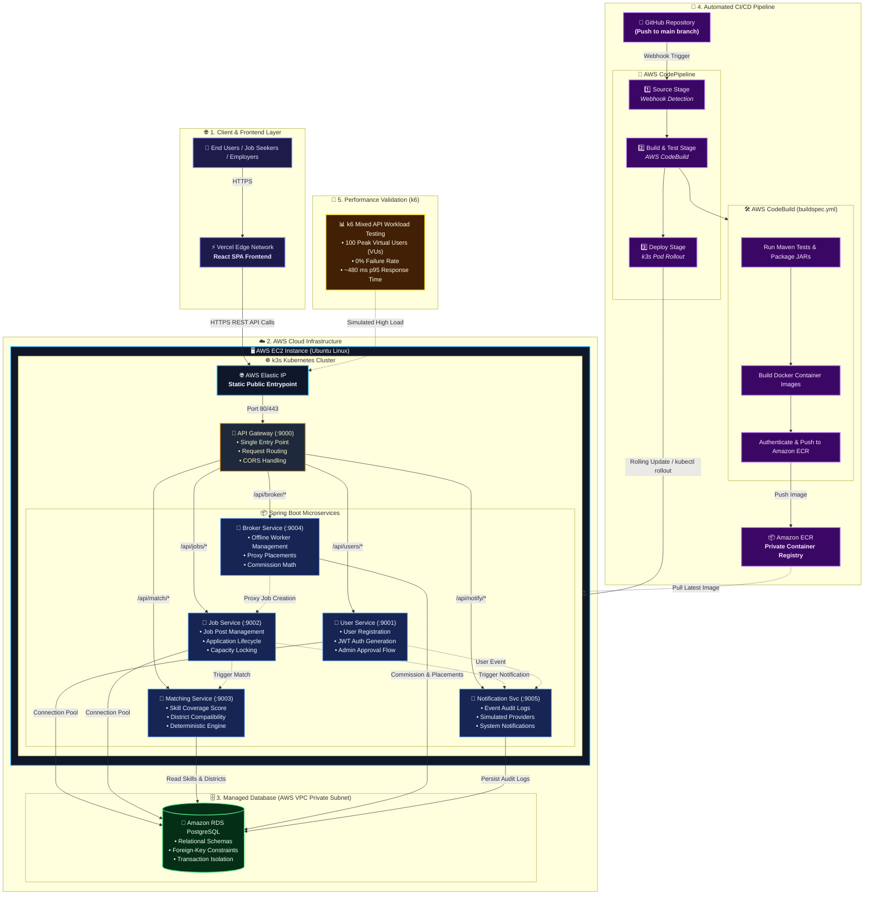
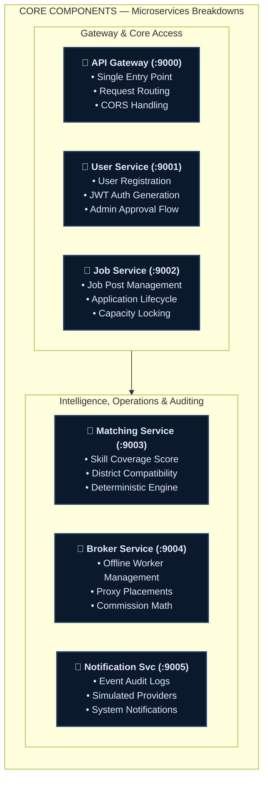
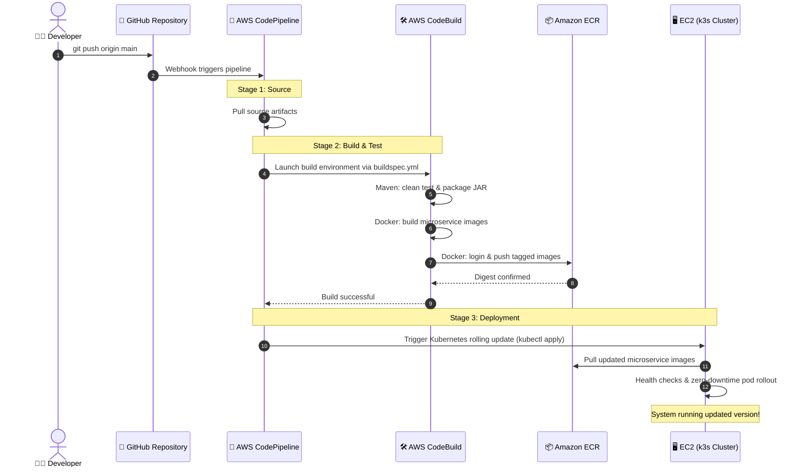

# Lanka MicroJob — Architecture & Microservices Specification

This document contains the official Mermaid.js architecture diagrams for **Lanka MicroJob**, matching all services, ports, deployment infrastructure, CI/CD pipeline, and performance load test metrics.

---

## 1. Complete System Architecture & Deployment Diagram

---

## 2. Core Components: Microservices Breakdown

---

## 3. Dedicated AWS CI/CD Pipeline Flow (Sequence Diagram)

